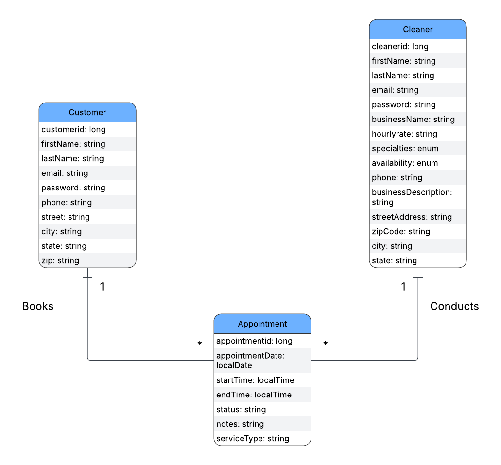

# CleanSweep backend API

# UML Class Diagram




# API Overview

## Customer

| Method | Path                            | Purpose                                                    | Response code | Error codes | User story                                                              | who implemented |
| ------ | ------------------------------- | ---------------------------------------------------------- | ------------- | ----------- | ----------------------------------------------------------------------- | --------------|
| `POST` | `/api/customers`                | Register a customer profile                                | `201 Created` | `400, 409`  | [US-1](../docs/CleanSweepSRS.md#L44) |       Millard C                               |
| `GET`  | `/api/customers/{customerId}`   | Read a customer profile                                    | `200 OK`      | `404`       | [US-1](../docs/CleanSweepSRS.md#L44) |        Millard C                                |
| `GET`  | `/api/cleaners`   |  browse and search cleaners                                    | `200 OK`      | `404`       | [US-2](../docs/CleanSweepSRS.md#L55) |        Millard C                                |
| `PUT`  | `/api/customers/{customerId}`   | Update a customer profile                                  | `200 OK`      | `400, 404, 409` | [US-1](../docs/CleanSweepSRS.md#L44) |         Millard C                            |
| `POST` | `/api/customers/login`                | login as a customer                                  | `201 Created` | `400, 409`  | [US-1](../docs/CleanSweepSRS.md#L44) |       Millard C                               |
### Customer 

```http
POST /api/customers
Content-Type: application/json

{
  "customerId": 1,  
  "firstName": "John",
  "lastName": "Pork",
  "email": "john.doe@example.com",
  "phoneNumber": "+1-212-667-0907",
  "city": "Cary",
  "state": "NC",
  "zip": "60749"

  
}
```

## Cleaner

| Method | Path                            | Purpose                                                    | Response code | Error codes | User story                                                              | who implemented |
| ------ | ------------------------------- | ---------------------------------------------------------- | ------------- | ----------- | ----------------------------------------------------------------------- | --------------|
| `POST` | `/api/cleaners`                 | Register a cleaner profile                                 | `201 Created` | `400, 409`  | [US-20](../docs/CleanSweepSRS.md#L88) |          Ronny K                            |
| `PUT`  | `/api/cleaners/{cleanerId}` | Update a cleaner profile | `200 OK`      |   `400, 404, 409`        | [US-20](../docs/CleanSweepSRS.md#L88), [US-21](../docs/CleanSweepSRS.md#L99)  |                  Ronny K                  |
| `GET`  | `/api/cleaners/{cleanerId}`     | Read a cleaner profile                                     | `200 OK`      | `404`       | [US-20](../docs/CleanSweepSRS.md#L88) |            Ronny K                          |
| `POST` | `/api/cleaners/login`                | login as a cleaner                                | `201 Created` | `400, 409`  | [US-20](../docs/CleanSweepSRS.md#L88) |       Millard C                               |

### Cleaner

```http
GET /api/customers
Content-Type: application/json

{
  "cleanerId": 1, 
  "firstName": "Steve",
  "lastName": "Fox",
  "email": "SteveFox90@example.com",
  "phoneNumber": "+1-882-976-0808",
  "businessName": "Steve Cleaning Company",
  "businessDescription": "I like cleaning!",
  "specialties": "pet-friendly",
  "availability": "Monday, Wednesday, Friday",
  "streetAdress": "1239 AppleCider street",
  "city": "Cary",
  "state": "NC",
  "zipCode": "60756",
  "hourlyRate": "30.00"

  
}
```
## Appointment

| Method | Path                            | Purpose                                                    | Response code | Error codes | User story                                                              | who implemented |
| ------ | ------------------------------- | ---------------------------------------------------------- | ------------- | ----------- | ----------------------------------------------------------------------- | --------------|
| `POST` | `/api/customers/{customerId}/appointments`                | Book an appointment with cleaners                                | `201 Created` | `400, 409`  | [US-3](../docs/CleanSweepSRS.md#L65) |       Millard C                               |
| `DELETE`  | `/api/appointments/{id}`   | Cancel an appointment by customer or cleaner                               | `200 OK`      | `404`       | [US-4](../docs/CleanSweepSRS.md#L76), [US-30](../docs/CleanSweepSRS.md#L109) |        Millard C                                |
| `GET`  | `/api/customers/{customerId}/appointments`   | view appointment                               | `200 OK`      | `404`       | [US-4](../docs/CleanSweepSRS.md#L76), [US-3](../docs/CleanSweepSRS.md#L65) |        Millard C                                |

## Appointment
```http
GET /api/customers/{customerId}/appointments
Content-Type: application/json

{
 "cleanerId": 1,
"appointmentDate": "2026-10-23",
 "startTime": "09:00",
 "endTime": "11:00",
 "serviceType": "Deep Cleaning",
 "notes": "Testing"

  
}
```
## Render
will take a while to deploy, so, please be patient. Thank you

Render url: https://f26-team4.onrender.com/api

